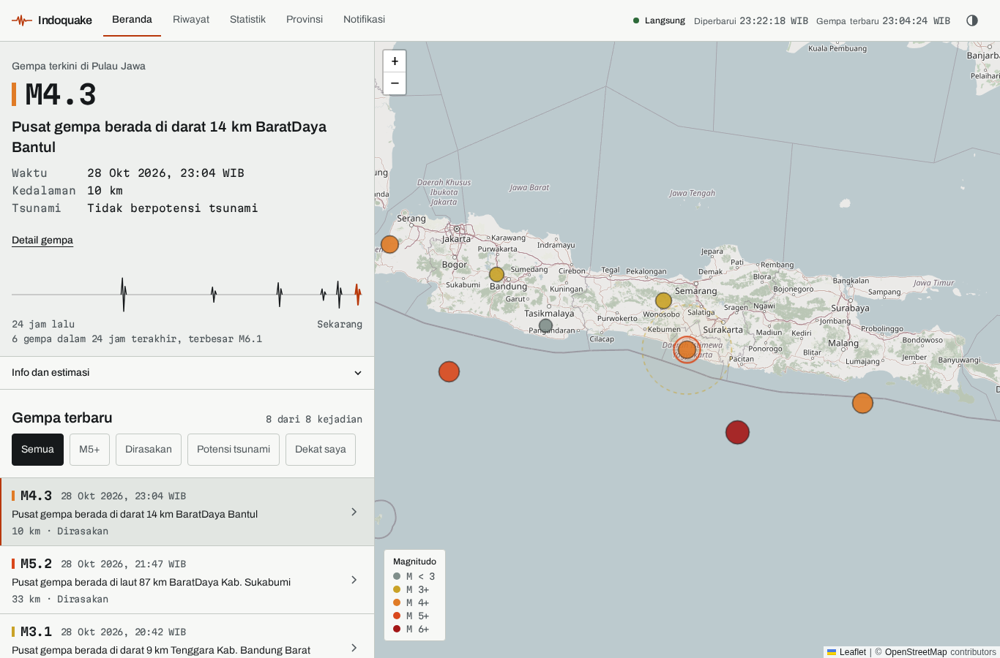
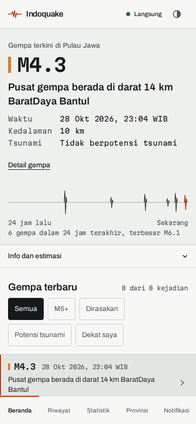
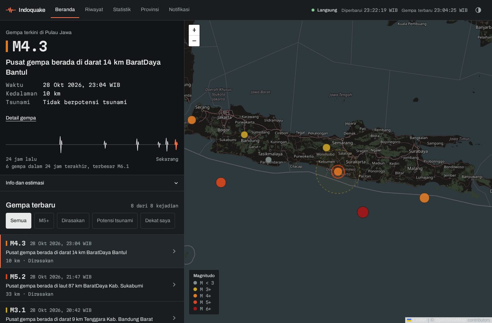
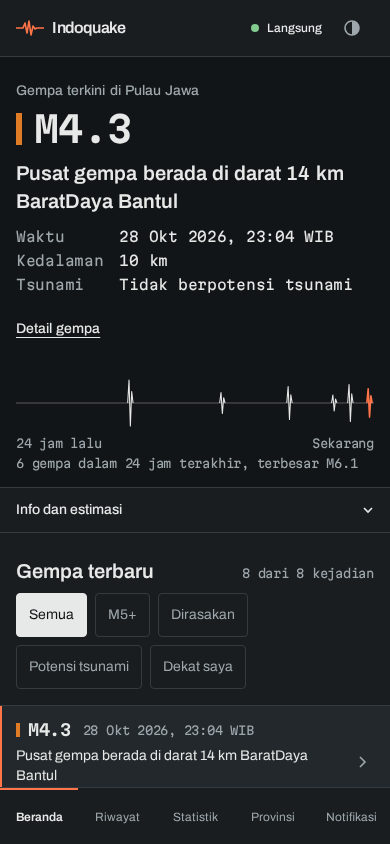
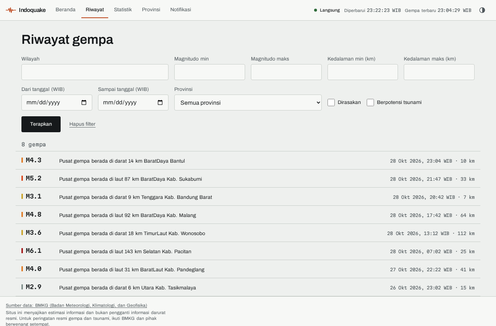
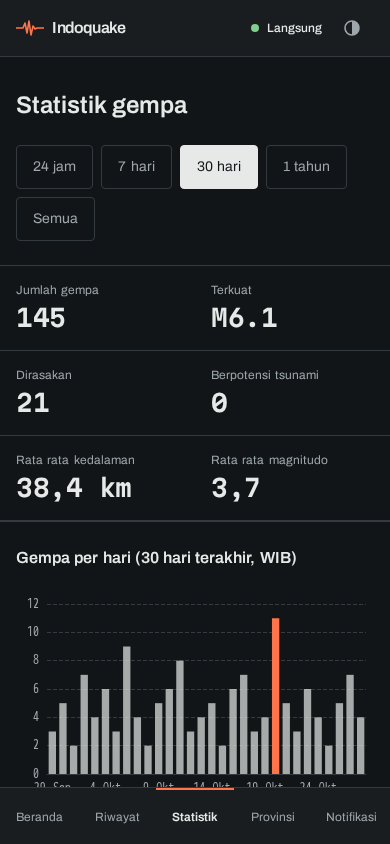

# Indoquake

Live earthquake and tsunami status for the island of Java, built on BMKG open data. The worker polls the three BMKG feeds, stores every event, and the web app shows a new quake within about 15 seconds over Server-Sent Events, with an honest "last updated" time and a banner when BMKG data stops arriving. The interface is in Indonesian.

Live site: https://indoquake.indonode.net

Bahasa Indonesia: [README.id.md](README.id.md)

## Screenshots

| Desktop | Phone |
| --- | --- |
|  |  |
|  |  |
|  |  |

## Architecture

```
BMKG open data (3 JSON feeds)
        |  per feed: autogempa 10 s, gempaterkini 20 s, gempadirasakan 30 s
        v
apps/worker  -- dedup (60 s / 50 km), merge, revisions --> PostgreSQL (earthquakes, event_log)
        |                                                      |
        +-- Redis publish (indoquake:events) + heartbeat --+   |
                                                           v   v
apps/web (Next.js)  /api/v1/* JSON  +  /api/v1/stream (SSE: ready, status, ping, earthquake, resync)
        |
        v
Browser: live list and map, status indicator (Langsung / Tertunda / Terputus), history, statistics
```

- `apps/web`: Next.js app router. Pages: `/`, `/riwayat`, `/statistik`, `/provinsi`, `/provinsi/[slug]`, `/gempa/[eventKey]`, `/notifikasi`. Design notes in [docs/design/README.md](docs/design/README.md).
- `apps/worker`: BMKG poller, store, event outbox, notifications.
- `apps/e2e`: Playwright tests (`mocked`, `full`, `shots` projects).
- `packages/*`: BMKG parsing, database schema and migrations, earthquake maths (ETA, MMI, statistics), regions, tsunami status, notifications, shared contract types.

## Data source and BMKG terms

All earthquake parameters come from BMKG (Badan Meteorologi, Klimatologi, dan Geofisika) through https://data.bmkg.go.id/gempabumi/. BMKG asks for at most 60 requests per minute per IP and for BMKG to be named as the source in the app. Indoquake sends about 11 requests per minute (hard cap 30) and shows the attribution on every page. Basemap tiles: OpenStreetMap contributors; CARTO basemaps only when `NEXT_PUBLIC_CARTO_API_KEY` is set at build time.

The tsunami status is taken only from BMKG's `Potensi` field. Indoquake never declares a tsunami itself. Distances, arrival times and intensities on the home page are estimates and are labelled Estimasi.

## API

All responses are JSON with `Cache-Control: no-store`; errors are `{ "error": "<short Indonesian text>" }`.

| Method | Path | Notes |
| --- | --- | --- |
| GET | `/api/v1/earthquakes` | `limit` (1 to 500), `page`, `minMagnitude`, `maxMagnitude`, `minDepthKm`, `maxDepthKm`, `from`, `to` (ISO 8601), `felt=true`, `tsunami=true`, `province=<slug>`, `q` (2 to 60 chars), `order=desc` or `asc` |
| GET | `/api/v1/earthquakes/[eventKey]` | detail with feeds and revisions (newest first); unknown key: 404 |
| GET | `/api/v1/statistics` | `period=24h`, `7d`, `30d`, `1y` or `all`; `province=<slug>` |
| GET | `/api/v1/health` | database, Redis, worker heartbeat and data freshness (`fresh`, `stale`, `down`, `unknown`) |
| GET | `/api/v1/time`, `/api/v1/geocode`, `/api/v1/felt-locations` | server time, reverse geocoding, felt report locations |
| POST, GET, DELETE | `/api/v1/subscriptions` | Telegram or Discord alerts; 10 per hour per IP |
| POST | `/api/v1/subscriptions/test` | sends a sample message; 5 per minute per IP |
| GET | `/api/v1/stream` | Server-Sent Events: `ready`, `status`, `ping` every 15 s, `earthquake` with `id`, `resync`; reconnect with `Last-Event-ID` |

## Run, test and deploy

```bash
npm install
npm run dev                          # web on http://localhost:3000 (needs DATABASE_URL, REDIS_URL)
npm run dev:worker                   # BMKG poller
npm run typecheck
npm run lint
npm test                             # unit tests, no browser
npm run build
npm run e2e -w @indoquake/e2e        # Playwright, mocked API, no database needed
npm run e2e:full -w @indoquake/e2e   # real PostGIS and Redis via Testcontainers (Docker)
npm run e2e:shots -w @indoquake/e2e  # regenerates docs/screenshots
```

Production runs on one host with Docker Compose (web, worker, PostgreSQL with PostGIS, Redis) behind nginx and certbot: `docker compose -f deploy/compose.prod.yml --env-file .env up -d --build`. The full procedure, without host details, is in `docs/DEPLOY.md`.

## Safety

Situs ini menyajikan estimasi informasi dan bukan pengganti informasi darurat resmi. Untuk peringatan resmi gempa dan tsunami, ikuti BMKG dan pihak berwenang setempat.

(This site presents estimated information and is not a substitute for official emergency information. For official earthquake and tsunami warnings, follow BMKG and local authorities.)
